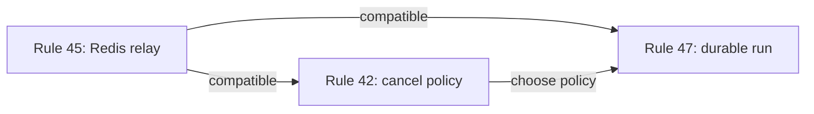

# Real-time, Streaming, and Agent Runs (Angie)

Angie is an agent platform — streaming and real-time aren't a side concern, they are the product. These rules cover the surfaces where it's most expensive to be wrong.

Rules in this skill: 41 (pick SSE or WebSocket deliberately), 42 (LLM stream cancellation and backpressure), 43 (WebSocket Gateway is thin transport), 44 (authenticate at handshake), 45 (scale via Redis adapter), 46 (rooms namespaced by tenant), 47 (agent runs as durable resources), 48 (structured agent events, not free text), 49 (idempotency keys on agent runs), 50 (heartbeat and reconnect as part of the protocol).

---

## 41. Pick one mechanism per flow — don't confuse SSE with WebSocket

- **SSE (Server-Sent Events)** — one-way stream from server to client. Ideal for LLM token streaming, job progress, notifications.
- **WebSocket** — bidirectional. Required only when the client sends frequent unsolicited messages (collaborative editing, user-to-user chat).
- **Long polling** — fallback, not default.

**Why it matters**
- WebSocket is operationally more expensive (sticky sessions, scaling, connections that don't close).
- For LLM response streaming — SSE wins big: works through HTTP/2, through proxies, with regular infrastructure.

❌ Bad — WebSocket for a one-way LLM stream:

```typescript
@WebSocketGateway()
export class ChatGateway {
  @SubscribeMessage('prompt')
  async handlePrompt(@MessageBody() data: any, @ConnectedSocket() client: Socket) {
    for await (const token of this.llm.stream(data.prompt)) {
      client.emit('token', token);
    }
  }
}
```

Reconnect, multi-instance, socket auth — overkill.

✅ Good — SSE:

```typescript
@Controller('chat')
export class ChatController {
  @Post('stream')
  @Sse()
  async stream(@Body() dto: PromptDto): Promise<Observable<MessageEvent>> {
    return new Observable((subscriber) => {
      (async () => {
        try {
          for await (const token of this.llm.stream(dto.prompt)) {
            subscriber.next({ data: { token } });
          }
          subscriber.complete();
        } catch (err) {
          subscriber.error(err);
        }
      })();
    });
  }
}
```

SSE works through HTTP, fits a regular load balancer, and the browser has reconnect built in.

---

## 42. LLM streaming — cancellation and backpressure are mandatory

The user closes the tab mid-response? The OpenAI call must abort. The server stops paying.
The LLM emits faster than the client can consume? Push backpressure.

**Why it matters**
- Without cancellation, you pay for a response no one reads. At scale this is real money.
- Without backpressure, the server accumulates unsent responses and explodes on memory.

❌ Bad:

```typescript
async streamPrompt(prompt: string, res: Response) {
  const stream = await this.openai.chat.completions.create({
    model: 'gpt-4', messages: [{ role: 'user', content: prompt }], stream: true,
  });
  for await (const chunk of stream) {
    res.write(`data: ${JSON.stringify(chunk)}\n\n`);
    // what if the client disconnected?
  }
}
```

✅ Good:

```typescript
@Sse('stream')
stream(@Body() dto: PromptDto, @Req() req: Request): Observable<MessageEvent> {
  const abortController = new AbortController();
  req.on('close', () => abortController.abort());

  return new Observable((subscriber) => {
    (async () => {
      try {
        const stream = await this.openai.chat.completions.create({
          model: 'gpt-4',
          messages: [{ role: 'user', content: dto.prompt }],
          stream: true,
        }, { signal: abortController.signal });

        for await (const chunk of stream) {
          if (abortController.signal.aborted) break;
          subscriber.next({ data: chunk });
        }
        subscriber.complete();
      } catch (err) {
        if (!abortController.signal.aborted) subscriber.error(err);
      }
    })();

    return () => abortController.abort();
  });
}
```

Client disconnects → the LLM call stops → you don't pay for the rest.

### Cancellation mode depends on run durability (rules 47, 45)

The example above applies to **ephemeral streams** — no durable run, no Redis resume. When you implement **durable / resumable runs** (rule 47) with cross-instance relay (rule 45), HTTP disconnect is not always abandonment.

| Mode | When | Cancel on HTTP disconnect? |
| --- | --- | --- |
| **Ephemeral** | One-shot SSE, no resume | Yes — `req.on('close')` → abort |
| **Durable / resumable** | Run persisted, Redis buffer, `GET .../stream` resume | **Ask the user** — product trade-off, not a fixed default |
| **Cost guard** (add-on) | Durable + idle timeout | Abort if no consumer reconnects within N minutes |
| **Explicit only** | Host opts into cost-first | Only `DELETE` / Stop aborts |

Page refresh and tab close look **identical** to the server (TCP drop). For durable/resumable runs, **ask the user** before choosing cancel-on-disconnect — unconditional `req.on('close')` abort breaks page-refresh resume, but keeping the LLM alive after every drop wastes cost.

When the run is durable/resumable, present these options and record the choice:

- **Resume-first** — keep generating after disconnect; client rejoins via `GET .../stream` (page refresh works)
- **Cost guard** — resume-first plus idle timeout: abort upstream if no resume GET within N minutes
- **Abort-on-disconnect** — `req.on('close')` → abort (cost-first; breaks page-refresh resume unless the client never reloads mid-run)
- **Explicit cancel only** — only `DELETE .../stream`, Stop button, or `POST .../cancel` aborts upstream (always required regardless of policy)

Backpressure (second half of rule 42) applies in **both** modes — propagate consumer backpressure to the LLM stream regardless of cancel policy.

---

## 43. WebSocket Gateways — thin transport, not business logic

In NestJS, a WebSocket gateway has one responsibility. It does not share state with controllers, and business logic does not live inside it.

**Why it matters**
- The gateway is transport, not business logic. It receives a message, authorizes, hands off to a service.
- The same service must be reachable over HTTP for debugging and tests, without a socket.

❌ Bad:

```typescript
@WebSocketGateway()
export class CollaborationGateway {
  private documents = new Map<string, Document>();   // ← state in gateway

  @SubscribeMessage('edit')
  handleEdit(@MessageBody() data: EditMessage) {
    const doc = this.documents.get(data.docId);
    doc.applyEdit(data.edit);
    // no way to test without opening a socket
  }
}
```

✅ Good:

```typescript
@Injectable()
export class CollaborationService {
  async applyEdit(docId: string, edit: Edit, userId: string): Promise<EditResult> {
    const doc = await this.repo.findById(docId);
    if (!this.policy.canEdit(user, doc)) throw new ForbiddenException();
    return doc.apply(edit);
  }
}

@WebSocketGateway()
export class CollaborationGateway {
  constructor(private collab: CollaborationService) {}

  @UseGuards(WsAuthGuard)
  @SubscribeMessage('edit')
  async handleEdit(@MessageBody() data: EditDto, @ConnectedSocket() client: AuthedSocket) {
    const result = await this.collab.applyEdit(data.docId, data.edit, client.userId);
    this.server.to(data.docId).emit('edit-applied', result);
  }
}
```

---

## 44. WebSocket auth — at handshake, not per message

On `connect`, the client sends a token (in `socket.io` `auth`, in a query, or in `Sec-WebSocket-Protocol`). If invalid → immediate disconnect. Each subsequent message reads the user from the socket context.

**Why it matters**
- Authenticating per message = JWT verify on every keystroke. Expensive.
- An unauthenticated open connection is a resource leak.

✅ Good:

```typescript
@WebSocketGateway()
export class ChatGateway implements OnGatewayConnection {
  async handleConnection(client: Socket) {
    try {
      const token = client.handshake.auth.token;
      const user = await this.jwt.verify(token);
      (client as AuthedSocket).user = user;
    } catch {
      client.disconnect();
    }
  }
}

@Injectable()
export class WsAuthGuard implements CanActivate {
  canActivate(ctx: ExecutionContext): boolean {
    const client = ctx.switchToWs().getClient<AuthedSocket>();
    return !!client.user;
  }
}
```

---

## 45. Scaling real-time — via Redis adapter, not in-memory

The moment you have more than one server instance, you can't keep connections in process memory. Redis (or similar) is the broker that fans events between instances.

**Why it matters**
- Without it, user A is on instance 1, user B on instance 2 — they don't see each other.
- Every real-time system going to production needs this on day one, or it will hurt later.

✅ Good:

```typescript
// apps/api/src/main.ts
import { IoAdapter } from '@nestjs/platform-socket.io';
import { createAdapter } from '@socket.io/redis-adapter';

const app = await NestFactory.create(AppModule);
const pubClient = new Redis(config.REDIS_URL);
const subClient = pubClient.duplicate();

const ioAdapter = new IoAdapter(app);
(ioAdapter as any).createIOServer = (port: number, options: any) => {
  const server = new Server(port, options);
  server.adapter(createAdapter(pubClient, subClient));
  return server;
};
app.useWebSocketAdapter(ioAdapter);
```

`server.to(roomId).emit(...)` now reaches every instance and every user in the room.

For **SSE resumable streams**, the same Redis (or similar) broker lets instance B serve a `GET .../stream` resume when instance A handled the original `POST /stream`. That satisfies rule 45 for relay — it does **not** require keeping the LLM alive after disconnect. Relay + abort-on-idle is valid.

---

## 46. Rooms and channels — always namespaced by domain and tenant

A room in `socket.io` or a topic in a message broker must include the tenant. `room: doc-123` is wrong. `room: org-456:doc-123` is right.

**Why it matters**
- Without namespacing, a name collision between orgs = a user receives another org's events. Data leak.
- Same problem as multi-tenancy in the DB, but on the real-time channel.

❌ Bad:

```typescript
client.join(`doc-${docId}`);
this.server.to(`doc-${docId}`).emit('update', data);
```

✅ Good:

```typescript
// libs/shared/backend-realtime/src/lib/rooms.ts
export function docRoom(orgId: string, docId: string) {
  return `org:${orgId}:doc:${docId}`;
}

client.join(docRoom(user.orgId, docId));
this.server.to(docRoom(user.orgId, docId)).emit('update', data);
```

---

## 47. Agent runs are a resource, not an ephemeral stream

An agent run (the text streaming to the user) is a resource with an ID — not just a passing stream. It is persisted in the DB with state (`pending`, `running`, `completed`, `failed`, `canceled`), accumulated output, and tool calls.

**Why it matters**
- The user closes the tab mid-response and re-opens — you need to show where it stopped.
- You need history, debugging, and a record of what you paid for.
- Two devices of the same user need to see the same run.

❌ Bad:

```typescript
@Sse('chat')
async chat(@Body() dto: PromptDto) {
  // streaming straight to the client, nothing persisted except the final message
}
```

✅ Good:

```typescript
@Post('runs')
async startRun(@Body() dto: StartRunDto, @CurrentUser() user: User): Promise<{ runId: string }> {
  const run = await this.runs.create({ userId: user.id, prompt: dto.prompt });
  this.queue.add('execute-run', { runId: run.id });
  return { runId: run.id };
}

@Sse('runs/:id/events')
streamRun(@Param('id') runId: string, @CurrentUser() user: User): Observable<MessageEvent> {
  return this.runs.subscribeToEvents(runId, user);
  // can also replay events that already happened, if the user joined late
}

@Get('runs/:id')
async getRun(@Param('id') runId: string, @CurrentUser() user: User): Promise<RunDto> {
  return this.runs.getForUser(runId, user);
}

@Post('runs/:id/cancel')
async cancel(@Param('id') runId: string, @CurrentUser() user: User) {
  await this.runs.cancel(runId, user);
}
```

The stream is a window into the resource, not the resource itself.

Implementing rule 47 requires a **documented disconnect policy** (see rule 42 cancellation modes and "How rules 42, 45, and 47 interact" below). Explicit cancel (`DELETE` / Stop) must exist. Client resume must not be broken by naive `req.on('close')` abort.

---

## 48. Tool calls and agent output — structured events, not free text

An agent's response streams as a sequence of typed events: `text-delta`, `tool-call-started`, `tool-call-completed`, `tool-call-failed`, `run-completed`. Not free text the client has to parse.

**Why it matters**
- The UI needs to know when to show a "searching the site" spinner, when to show the result, when to show an error. From free text — impossible.
- Typed events feed logging, analytics, and debugging — from the same stream.

✅ Good:

```typescript
// libs/studio/data-access/src/lib/run-events.ts
export type RunEvent =
  | { type: 'text-delta';          delta: string }
  | { type: 'tool-call-started';   toolCallId: string; tool: string; args: unknown }
  | { type: 'tool-call-completed'; toolCallId: string; result: unknown }
  | { type: 'tool-call-failed';    toolCallId: string; error: string }
  | { type: 'run-completed';       runId: string; tokensUsed: number }
  | { type: 'run-failed';          runId: string; error: string };

// frontend
sse.addEventListener('message', (e) => {
  const event = JSON.parse(e.data) as RunEvent;
  switch (event.type) {
    case 'text-delta':         appendText(event.delta); break;
    case 'tool-call-started':  showToolSpinner(event.tool); break;
    case 'tool-call-completed': showToolResult(event.toolCallId, event.result); break;
    // ...
  }
});
```

---

## 49. Idempotency keys on every agent action

The client sends an `Idempotency-Key` header on every run-creation request. If the request arrives twice (network, retry, double-click) — the server returns the same run, doesn't create a new one.

**Why it matters**
- Unreliable networks + client retries = duplicate runs of the same prompt = double charges.
- This is the industry standard (Stripe). For expensive agent runs — mandatory.

✅ Good:

```typescript
@Post('runs')
async startRun(
  @Body() dto: StartRunDto,
  @Headers('idempotency-key') idempotencyKey: string,
  @CurrentUser() user: User,
) {
  if (!idempotencyKey) throw new BadRequestException('Idempotency-Key header required');

  const existing = await this.runs.findByIdempotencyKey(user.id, idempotencyKey);
  if (existing) return { runId: existing.id, deduplicated: true };

  const run = await this.runs.create({ userId: user.id, prompt: dto.prompt, idempotencyKey });
  return { runId: run.id };
}
```

---

## 50. Heartbeats and reconnect — part of the protocol, not an add-on

- **SSE**: the server emits an empty comment (`:heartbeat\n\n`) every 15–30 seconds. On disconnect the client reconnects and sends `Last-Event-Id` to resume.
- **WebSocket**: built-in ping/pong (socket.io does this automatically), exponential backoff on reconnect.

**Why it matters**
- Proxies and load balancers close idle connections after ~60 seconds. Without heartbeats, the client thinks it's connected but isn't.
- LLM streaming has long pauses between tokens (tool calls). Heartbeats keep the connection alive.

✅ Good:

```typescript
@Sse('runs/:id/events')
streamRun(@Param('id') runId: string): Observable<MessageEvent> {
  return merge(
    this.runs.events(runId),
    interval(15_000).pipe(map(() => ({ type: 'heartbeat', data: '' } as MessageEvent))),
  );
}

// frontend
const sse = new EventSource(`/runs/${runId}/events`);
// EventSource auto-reconnects with Last-Event-Id, if the server emits `id:` on every event
```

---

## How rules 42, 45, and 47 interact

These rules are not in conflict — they address different layers. The common mistake is applying rule 42's ephemeral-stream example to a durable/resumable system.

| Rule | Layer | Answers |
| --- | --- | --- |
| **42** | Cost / cancellation | When should the upstream LLM stop generating? |
| **45** | Multi-instance relay | How do instances share stream state for resume? |
| **47** | Durable run | Is the run a persisted resource the client can rejoin? |



- **Rule 45 + 42:** Redis relay with abort-on-idle — relay stops receiving when upstream aborts.
- **Rule 45 + 47:** Redis relay with resume-first — disconnect keeps generating until explicit cancel or idle timeout.
- **Rule 42 + 47 tension:** resolved by cancel policy (ephemeral vs durable table under rule 42), not by dropping either rule.

**Page refresh:** client drops POST SSE → reload → `GET .../stream/status` → resume via `GET .../stream`. For durable/resumable hosts, ask the user whether disconnect should abort upstream or allow resume — do not assume resume-first without confirmation.
